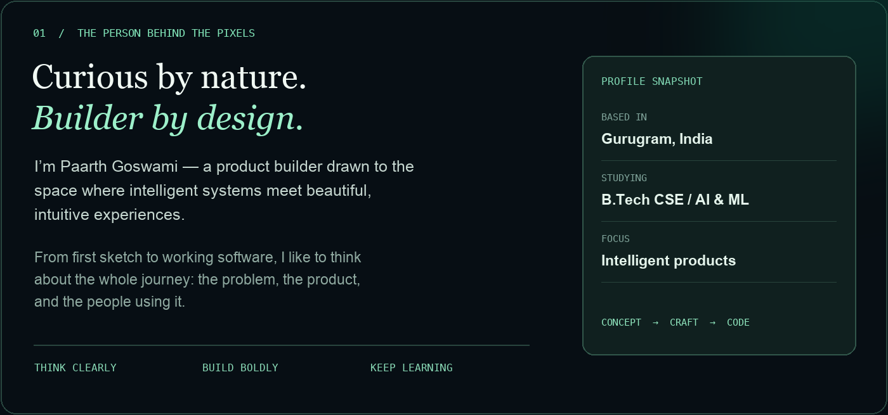
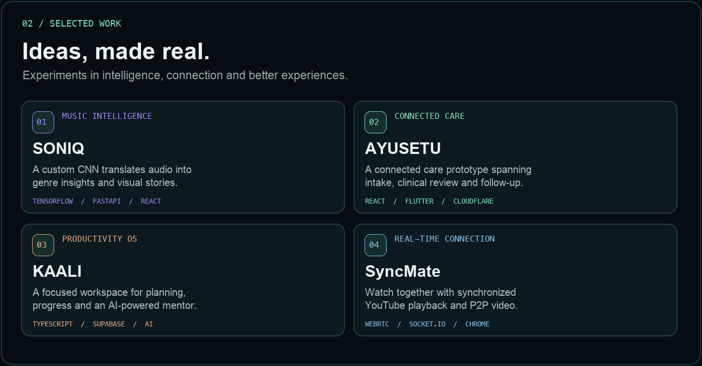
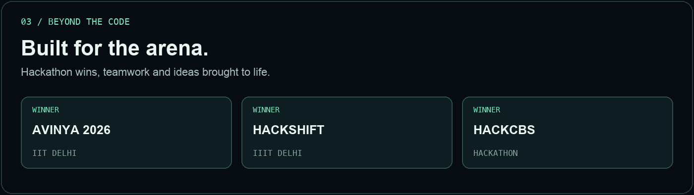

  
   
  
  
  
    
  

 

More about me

I’m Paarth Goswami, a B.Tech CSE (AI/ML) student in Gurugram. I build intelligent products, bringing together design, machine learning and full-stack engineering from the first sketch through to working software.

 

  
  
  
  

 

  

## `04 / THE TOOLBOX` &nbsp; Tools for the craft

  
<strong>INTELLIGENCE &nbsp; / &nbsp; FRONTEND &nbsp; / &nbsp; BACKEND &nbsp; / &nbsp; DELIVERY</strong>

  

 

## `05 / BUILDING IN PUBLIC` &nbsp; The contribution graph

  
  Every square is a step in the process. &nbsp; ✦ &nbsp; <a href="https://github.com/Paarth-dev-lab?tab=repositories">Explore all repositories ↗</a>

 

---

   
  <strong>HAVE AN IDEA WORTH BUILDING?</strong>  
  Let's make something meaningful together.  
  <a href="https://paarths-portfolio.vercel.app/">Portfolio ↗</a> &nbsp; · &nbsp; <a href="https://www.linkedin.com/in/paarth-goswami-113383370">LinkedIn ↗</a> &nbsp; · &nbsp; <a href="mailto:thepaarthgoswami@gmail.com">Email ↗</a>
    DESIGNED WITH INTENT &nbsp; / &nbsp; BUILT BY PAARTH

