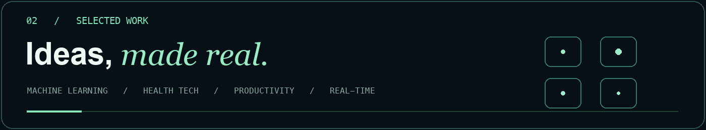

  
   
  
  
  
    
  

 

More about me

I’m Paarth Goswami, a B.Tech CSE (AI/ML) student based in Gurugram, India. I enjoy building intelligent products that bring together thoughtful interfaces, machine learning and full-stack engineering.

My work spans training models, designing interactive experiences and connecting frontends to the systems behind them. Hackathons have taught me to collaborate, move quickly and turn an ambitious idea into a working prototype. I like carrying that same curiosity into every project: understand the problem, build with intent and keep refining the details.

 

 

<table>
<tr>
<td width="50%" valign="top">
  <strong>01 &nbsp; / &nbsp; MACHINE LEARNING</strong>
  <h3>SONIQ &nbsp; · &nbsp; See the sound</h3>
  
A music intelligence studio that turns audio into genre insights through a custom CNN and an interactive dashboard.

  
<strong>THE EXPERIENCE</strong> Waveform, spectrogram and genre scores in one place; from model training through to inference.

  

  
</td>
<td width="50%" valign="top">
  <strong>02 &nbsp; / &nbsp; HEALTH TECH</strong>
  <h3>AYUSETU &nbsp; · &nbsp; Connected care</h3>
  
A connected-care prototype bringing intake, clinical review, pharmacy and follow-up together across web and mobile.

  
<strong>THE EXPERIENCE</strong> Language support, rule-based workflows and at-home follow-up. Prototype using synthetic data; not for patient care.

  

  
</td>
</tr>
<tr>
<td width="50%" valign="top">
  <strong>03 &nbsp; / &nbsp; PRODUCTIVITY &amp; AI</strong>
  <h3>KAALI &nbsp; · &nbsp; Own your day</h3>
  
A personal productivity command centre for planning, tracking progress and working with an AI mentor.

  
<strong>THE EXPERIENCE</strong> Organise tasks and goals, track consistency, and interact through voice and Telegram.

  

  
</td>
<td width="50%" valign="top">
  <strong>04 &nbsp; / &nbsp; REAL-TIME COMMUNICATION</strong>
  <h3>SyncMate &nbsp; · &nbsp; Watch together</h3>
  
A Chrome extension for synchronised YouTube playback and peer-to-peer video, wherever you are.

  
<strong>THE EXPERIENCE</strong> Shared play, pause and seek; WebRTC media, Socket.IO signaling and an isolated Shadow DOM overlay.

  

  
</td>
</tr>
</table>

 

  

Language percentages are based on GitHub-reported code bytes in the four featured repositories, captured 13 November 2026. They are a snapshot, not a measure of skill; AYUSETU refers to the team repository. Values are rounded.

 

## `05 / THE TOOLBOX` &nbsp; Tools for the craft

  
<strong>INTELLIGENCE &nbsp; / &nbsp; FRONTEND &nbsp; / &nbsp; BACKEND &nbsp; / &nbsp; DELIVERY</strong>

  

 

## `06 / BUILDING IN PUBLIC` &nbsp; The contribution graph

  
  Every square is a step in the process. &nbsp; ✦ &nbsp; <a href="https://github.com/Paarth-dev-lab?tab=repositories">Explore all repositories ↗</a>

 

---

   
  <strong>HAVE AN IDEA WORTH BUILDING?</strong>  
  Let's make something meaningful together.  
  <a href="https://paarths-portfolio.vercel.app/">Portfolio ↗</a> &nbsp; · &nbsp; <a href="https://www.linkedin.com/in/paarth-goswami-113383370">LinkedIn ↗</a> &nbsp; · &nbsp; <a href="mailto:thepaarthgoswami@gmail.com">Email ↗</a>
    DESIGNED WITH INTENT &nbsp; / &nbsp; BUILT BY PAARTH

