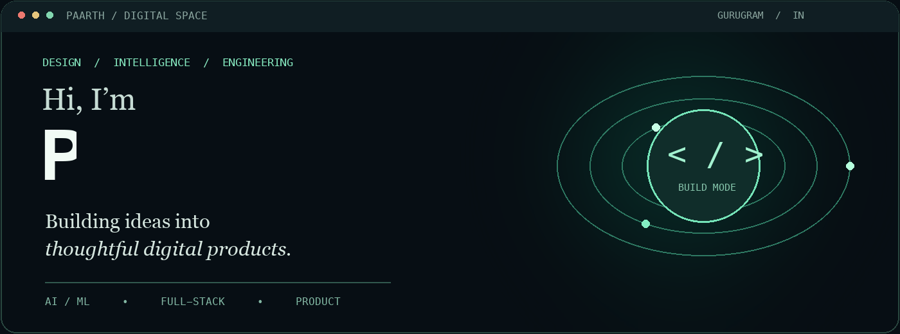
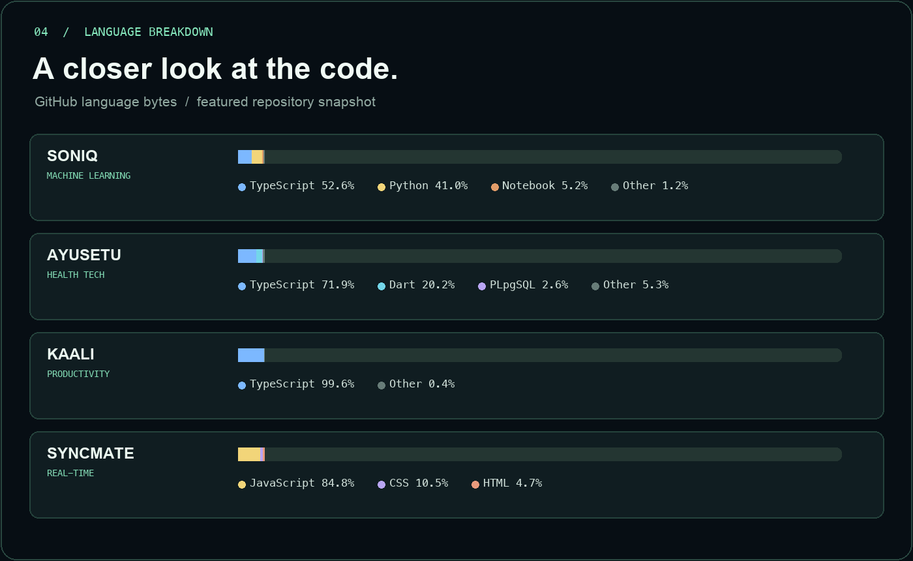

  
   
  
  
  
    
  

 

More about me

I’m Paarth Goswami, a B.Tech CSE (AI/ML) student based in Gurugram, India. I enjoy building intelligent products that bring together thoughtful interfaces, machine learning and full-stack engineering.

My work spans training models, designing interactive experiences and connecting frontends to the systems behind them. Hackathons have taught me to collaborate, move quickly and turn an ambitious idea into a working prototype. I like carrying that same curiosity into every project: understand the problem, build with intent and keep refining the details.

 

## `02 / SELECTED WORK` &nbsp; Ideas, made real

From machine learning and healthcare to productivity and real-time communication — each project starts with a problem and becomes a complete experience.

### 🧠 &nbsp; Machine Learning · SONIQ

A music genre classification system that turns an audio file into an interactive visual and analytical experience. A custom CNN learns from log-Mel spectrograms; a FastAPI service exposes inference to a React dashboard.

- Explore the **waveform, spectrogram and genre scores** in one interface.
- Follow the project from **dataset preparation and model training** to inference and the final dashboard.
- Built as an academic project with documented evaluation and limitations.

[Explore SONIQ ↗](https://github.com/Paarth-dev-lab/music-genre-classifier)

---

### 🩺 &nbsp; Health Tech · AYUSETU

A connected-care prototype bringing patient intake, clinical review, pharmacy and follow-up into one experience, across web and mobile interfaces.

- Brings together **patient intake, clinician review and pharmacy workflows**.
- Explores language support, rule-based decisions and at-home follow-up.
- Built as a **hackathon and engineering prototype** using synthetic data, not for patient care.

[Explore AYUSETU ↗](https://github.com/potlasrisharan/hackshift-sudarshan)

---

### ⚡ &nbsp; Productivity & AI · KAALI

A personal command centre for planning the day, tracking progress and working with an AI mentor across web and Telegram.

- Organise **tasks, goals and meetings** with progress and consistency views.
- Use **voice commands and Telegram** to interact with the mentor.
- Sync data through Supabase and build on a TypeScript web and API stack.

[Explore KAALI ↗](https://github.com/Paarth-dev-lab/KAALI-)

---

### 🌐 &nbsp; Real-time Communication · SyncMate

A Chrome extension that synchronizes YouTube playback and adds peer-to-peer video communication, built for people watching together at a distance.

- Synchronizes **play, pause and seek** across a shared room.
- Uses **WebRTC** for peer-to-peer media and Socket.IO for signaling.
- Keeps its overlay isolated with Shadow DOM and restores session state across navigation.

[Explore SyncMate ↗](https://github.com/Paarth-dev-lab/SyncMate-3)

 

  

Language percentages are based on GitHub-reported code bytes in the four featured repositories, captured 13 November 2026. They are a snapshot, not a measure of skill; AYUSETU refers to the team repository. Values are rounded.

 

## `05 / THE TOOLBOX` &nbsp; Tools for the craft

  
<strong>INTELLIGENCE &nbsp; / &nbsp; FRONTEND &nbsp; / &nbsp; BACKEND &nbsp; / &nbsp; DELIVERY</strong>

  

 

## `06 / BUILDING IN PUBLIC` &nbsp; The contribution graph

  
  Every square is a step in the process. &nbsp; ✦ &nbsp; <a href="https://github.com/Paarth-dev-lab?tab=repositories">Explore all repositories ↗</a>

 

---

   
  <strong>HAVE AN IDEA WORTH BUILDING?</strong>  
  Let's make something meaningful together.  
  <a href="https://paarths-portfolio.vercel.app/">Portfolio ↗</a> &nbsp; · &nbsp; <a href="https://www.linkedin.com/in/paarth-goswami-113383370">LinkedIn ↗</a> &nbsp; · &nbsp; <a href="mailto:thepaarthgoswami@gmail.com">Email ↗</a>
    DESIGNED WITH INTENT &nbsp; / &nbsp; BUILT BY PAARTH

