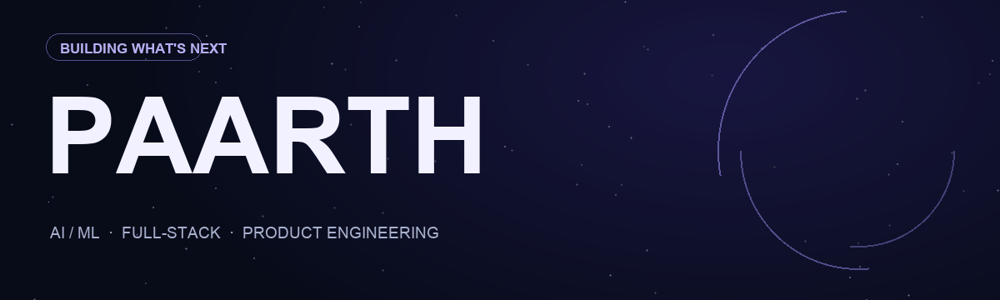
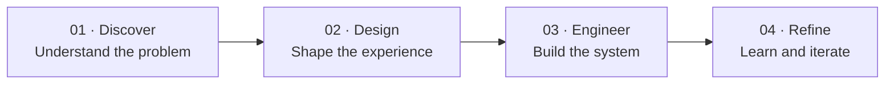

  
   
  
   
  
  
  
    
  <a href="#-about">ABOUT</a> &nbsp; / &nbsp; <a href="#-selected-work">SELECTED WORK</a> &nbsp; / &nbsp; <a href="#-hackathons">HACKATHONS</a> &nbsp; / &nbsp; <a href="#-toolbox">TOOLBOX</a> &nbsp; / &nbsp; <a href="#-lets-connect">CONNECT</a>

 

## ✦ About

<table>
<tr>
<td width="65%" valign="top">

**Hey, I'm Paarth Goswami.** I build at the intersection of intelligent systems, full-stack engineering and product design.

I like taking an idea beyond the prototype: understanding the problem, designing the experience and engineering the system that makes it work. From music intelligence to connected healthcare and real-time collaboration, I'm drawn to products that make complex technology feel intuitive.

</td>
<td width="35%" valign="top">

**BASED IN** Gurugram, India  
**FOCUS** AI / ML · Full-stack · Product  
**STUDYING** B.Tech in CSE (AI / ML)

</td>
</tr>
</table>

 

## ◈ Selected work

> A selection of ideas turned into working systems — spanning AI, health, productivity and real-time connection.

<table>
<tr>
<td width="50%" valign="top">
<h3>01 &nbsp; SONIQ</h3>

<strong>Music intelligence, made visible.</strong>

An end-to-end music genre classification experience with a custom CNN, audio visualization and an interactive analysis dashboard.

<code>Python</code> <code>TensorFlow</code> <code>FastAPI</code> <code>React</code>

<a href="https://github.com/Paarth-dev-lab/music-genre-classifier">Explore repository ↗</a>
</td>
<td width="50%" valign="top">
<h3>02 &nbsp; AYUSETU</h3>

<strong>A connected care prototype.</strong>

Bringing patient intake, clinical review, pharmacy and follow-up into one continuity-of-care experience.

<code>TypeScript</code> <code>React</code> <code>Flutter</code> <code>Cloudflare</code>

<a href="https://github.com/potlasrisharan/hackshift-sudarshan">Explore repository ↗</a>
</td>
</tr>
<tr>
<td width="50%" valign="top">
<h3>03 &nbsp; KAALI</h3>

<strong>A productivity operating system.</strong>

A personal productivity workspace combining planning, progress tracking and an AI mentor in one place.

<code>TypeScript</code> <code>React</code> <code>Express</code> <code>Supabase</code>

</td>
<td width="50%" valign="top">
<h3>04 &nbsp; SyncMate</h3>

<strong>Distance, a little less distant.</strong>

A Chrome extension for synchronized YouTube viewing and peer-to-peer video conversations.

<code>JavaScript</code> <code>WebRTC</code> <code>Socket.IO</code> <code>Chrome APIs</code>

</td>
</tr>
</table>

<a href="https://paarths-portfolio.vercel.app/">More of my work on the portfolio ↗</a>

 

## ◇ How I build

 

## ✧ Hackathons

Building under pressure, collaborating with teams and turning ideas into real demos. Proud to have won across these hackathons:

| Event | Venue |
|:--|:--|
| **Avinya 2026** | IIT Delhi |
| **HackShift** | IIIT Delhi |
| **HackCBS** | — |

 

## ⌘ Toolbox

<table>
<tr>
<td width="50%" valign="top"><strong>INTELLIGENCE &amp; DATA</strong>  </td>
<td width="50%" valign="top"><strong>INTERFACES</strong>  </td>
</tr>
<tr>
<td width="50%" valign="top"><strong>SYSTEMS &amp; DATA</strong>  </td>
<td width="50%" valign="top"><strong>BUILD &amp; SHIP</strong>  </td>
</tr>
</table>

 

## ↗ Let's connect

Have an interesting problem, project or idea? I'd love to hear about it.

  
DESIGNED WITH INTENT &nbsp; ✦ &nbsp; BUILT BY PAARTH

